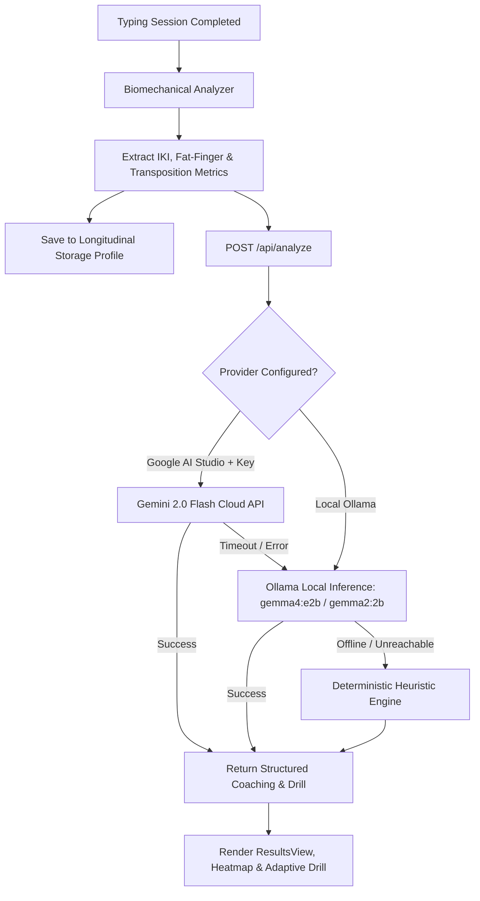
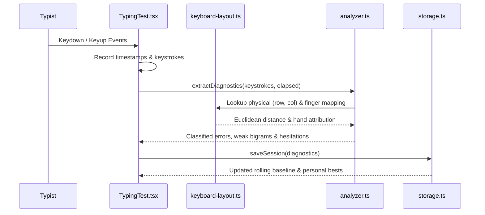

# TypoLoop

**Tactile Meditation & Biomechanical Touch-Typing Trainer**  
Powered by Google Gemma on the Edge, Artisanal Coffeehouse Aesthetics, and Web Audio Switch Acoustics.

[](https://nextjs.org/)
[](https://react.dev/)
[](https://tailwindcss.com/)
[](tests/)
[](LICENSE)

---

## Overview

TypoLoop reimagines touch-typing as an intentional, contemplative ritual rather than a frantic arcade game. Grounded in sensory ergonomics, it combines a warm, fibrous **"Light Roast"** cream palette (`#FBF8F3`) with dark-roasted espresso glyphs (`#2A1E17`), real-time mechanical switch acoustics, and deep neuromuscular analytics.

### Key Capabilities

- **Biomechanical Diagnostics:** Computes true Net WPM, Raw WPM, accuracy, and inter-keystroke intervals (IKI). Classifies adjacent fat-finger vs. transposition errors using physical QWERTY matrix coordinates and finger attribution.
- **Edge AI Coaching (Google Gemma):** Connects to local Ollama (`gemma2:2b` or `gemma4:e2b`) or Google Gemini 2.0 to deliver personalized diagnostic reviews and generate adaptive drills targeting weak bigrams.
- **Zero-Config Offline Fallback:** Works completely out of the box with zero external dependencies. If Ollama is unreachable and no API key is configured, the deterministic heuristic engine and curated passage library take over seamlessly.
- **Mechanical Switch Acoustics:** Web Audio API synthesizer modeling tactile Brown, clicky Blue, linear Red, deep Thock, and soft Bubble sound profiles without external audio assets.
- **Longitudinal Mastery Profile:** Tracks 10-session rolling baselines, consecutive-day streaks, personal bests, and persistent troublemaker bigrams in local storage with JSON export/import.
- **Curated Coffee & Tech Drills:** Pre-built passages covering pour-over rituals, 9-bar espresso extractions, Vim motions, and algorithmic syntax.

---

## System Architecture

### Request & AI Fallback Pipeline



### Biomechanical Telemetry Flow



---

## Quickstart

### 1. Clone & Install
```bash
git clone https://github.com/Sreeram5678/TypoLoop.git
cd TypoLoop
npm install
```

### 2. Automated Setup (Recommended)
Run the setup script to configure `.env.local`, verify Ollama, pull Gemma models, and run the test suite:
```bash
npm run setup
```

### 3. Start the Development Server
```bash
npm run dev
```
Open [http://localhost:3000](http://localhost:3000) in your browser.

---

## Automated Setup for AI Agents

If you are opening this repository in an AI-powered IDE (Antigravity, Cursor, Windsurf, Claude Code, GitHub Copilot), you can instruct your agent directly:

> *"Set up TypoLoop, configure environment variables, and download the recommended Ollama models."*

The agent will read [`AGENTS.md`](AGENTS.md) and execute `npm run setup` automatically.

---

## Local Edge AI Setup (Optional)

TypoLoop runs offline by default using its heuristic engine. To enable local AI inference with Google Gemma:

1. **Install Ollama:**
   - **macOS:** `brew install ollama && ollama serve`
   - **Linux:** `curl -fsSL https://ollama.com/install.sh | sh`
   - **Windows:** Download from [ollama.com/download](https://ollama.com/download)

2. **Pull a Gemma Model:**
   ```bash
   # Lightweight option (~1.6GB VRAM, fast responses)
   ollama pull gemma2:2b

   # Edge reasoning option
   ollama pull gemma4:e2b
   ```

3. **Cloud Gemini API (Alternative):**
   Obtain an API key from [Google AI Studio](https://aistudio.google.com), open the **Settings** modal in TypoLoop, select **Google AI Studio**, and enter your key (or set `GEMINI_API_KEY` in `.env.local`).

---

## Project Structure

```text
TypoLoop/
├── scripts/
│   └── setup.sh                 # Automated environment & Ollama setup
├── src/
│   ├── app/
│   │   ├── about/               # Interactive architecture & switch audio lab
│   │   ├── analytics/           # Speed & rhythm analytics dashboard
│   │   ├── api/
│   │   │   ├── analyze/         # AI coaching & heuristic fallback endpoint
│   │   │   └── generate-text/   # Adaptive story & drill generation endpoint
│   │   ├── coach/               # Dedicated AI biomechanics coach view
│   │   ├── drills/              # Curated coffee & technical drill packs
│   │   └── page.tsx             # Primary Practice Arena
│   ├── components/              # TypingTest, ResultsView, ProfileModal, Navbar, etc.
│   ├── context/                 # SettingsContext (localStorage persistence)
│   ├── lib/
│   │   ├── ai/prompts.ts        # Structured Gemma prompt templates
│   │   ├── analyzer.ts          # Biomechanical telemetry & error classification
│   │   ├── keyboard-layout.ts   # Physical QWERTY coordinates & finger mapping
│   │   ├── paragraphs.ts        # Curated passages & text normalization
│   │   ├── sound.ts             # Web Audio API switch synthesizer
│   │   └── storage.ts           # Longitudinal mastery & streak aggregator
│   └── types/                   # TypeScript interfaces for diagnostics & AI feedback
├── tests/                       # Unit & integration test suites (23 tests)
├── AGENTS.md                    # Instructions for AI coding assistants
└── .env.example                 # Environment variable template
```

---

## Keyboard Shortcuts

| Key | Action |
| :--- | :--- |
| `Tab` | Instant test restart with a fresh word stream |
| `Esc` | Reset current test back to start |
| `Space` | Advance to the next word |

---

## Testing & Verification

```bash
# Run all 23 unit and integration tests
npm test

# Run ESLint
npm run lint

# Create production build
npm run build
```

---

## License

MIT License.
